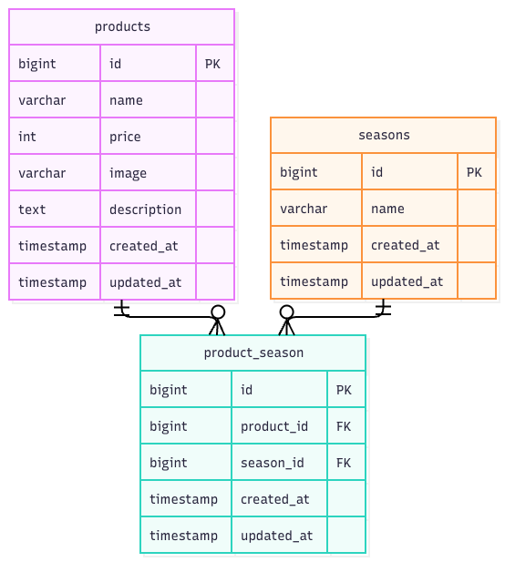

# もぎたて（mogitate）

## アプリケーション概要

野菜・果物のECサイト「もぎたて」の商品管理アプリケーションです。
商品の閲覧、キーワード・価格帯検索、価格順並び替え、新規登録、編集・更新、削除ができます。

## 環境構築

```bash
# 1. リポジトリのクローン
git clone https://github.com/ryohei470/mogitate.git
cd mogitate

# 2. 環境変数ファイルの作成
cp .env.example .env

# 3. Composerパッケージのインストール（vendor/bin/sail を生成）
docker run --rm \
    -v "$(pwd):/var/www/html" \
    -w /var/www/html \
    laravelsail/php84-composer:latest \
    composer install --ignore-platform-reqs

# 4. Dockerコンテナのビルド・起動
./vendor/bin/sail up -d

# 5. アプリケーションキーの生成
./vendor/bin/sail artisan key:generate

# 6. マイグレーションとダミーデータの投入
./vendor/bin/sail artisan migrate:fresh --seed

# 7. ストレージのシンボリックリンク作成
./vendor/bin/sail artisan storage:link
``

## 使用技術（実行環境）

- PHP 8.5.11
- Laravel 13.38.0
- MySQL 8.4.13
- Docker（Laravel Sail）

## URL

- 商品一覧画面：http://localhost/products
- 商品登録画面：http://localhost/products/register

## ER図


